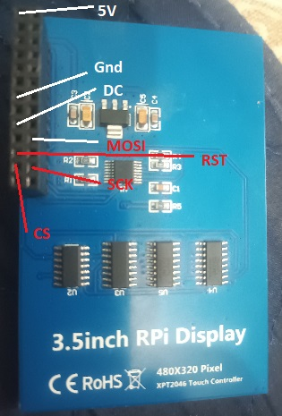

# esp-lcd-ili9486


ESP-IDF v5.5 / v6.x compatible **`esp_lcd` panel driver** for the **ILI9486 320×480 SPI TFT display**.

This component integrates with Espressif's `esp_lcd` abstraction layer and supports:

* Raw `esp_lcd` usage
* LVGL integration via `lvgl_port`

---

## Features

* Compatible with the `esp_lcd` panel API
* Native RGB565 pixel format — no conversion overhead
* Proper CASET/RASET coordinate window handling for SPI mode
* LVGL v9 compatible
* Configurable via Kconfig
* Includes working raw and LVGL examples
* Includes Unity hardware verification tests

---

## Chip Support

| Chip     | Status |
|----------|--------|
| ESP32    | ✅ Tested |
| ESP32-S2 | ⚠️ Expected to work |
| ESP32-S3 | ⚠️ Expected to work |
| ESP32-C3 | ✅ Tested |

---

## Installation

### Using ESP-IDF Component Manager (Recommended)

```bash
idf.py add-dependency "khiyamiftikhar/esp-lcd-ili9486^2.0.0"
```

Or in your project's `idf_component.yml`:

```yaml
dependencies:
  khiyamiftikhar/esp-lcd-ili9486: "^2.0.0"
```

Then configure via:

```
idf.py menuconfig
Component config → ILI9486 Panel Driver
```

### Upgrading from 1.x

Version 2.0.0 fixes the init sequence so the panel's settings are actually
applied. As a result, the image is no longer mirrored, so **remove**
`esp_lcd_panel_mirror(panel, true, false)` or LVGL `rotation.mirror_x = true`
if you added it as a workaround. See [CHANGELOG.md](CHANGELOG.md).

---

## Usage

After initializing the SPI bus and creating panel IO with:

```c
.lcd_cmd_bits   = 8
.lcd_param_bits = 8
```

Create the panel via `esp_lcd_new_panel_ili9486()` and use the standard `esp_lcd` API:

* `esp_lcd_panel_draw_bitmap()`
* `esp_lcd_panel_mirror()`
* `esp_lcd_panel_swap_xy()`
* `esp_lcd_panel_disp_on_off()`

For complete initialization flows, see the examples below.

---

## Examples

### `examples/basic_init`
Raw `esp_lcd` usage without LVGL: initializes the panel and runs colour,
addressing and orientation test patterns.

### `examples/lvgl_demo`
LVGL integration via `esp_lvgl_port`, with a full colour verification
sequence (primary colours, rainbow, widgets and a colour-cycling progress bar).

### `examples/ipcam`
Streams a live JPEG from an IP camera URL over HTTP and renders it to the panel
in 480×320 landscape mode, row by row. No framebuffer. Demonstrates SPI panel
init, DMA-backed row writes, FreeRTOS async decode, and HTTP streaming with an
input prefetch buffer.

### `examples/https`
Fetches the classic [Lenna](https://i.gzn.jp/img/2009/06/18/lenna/000.jpg)
test image over HTTPS and displays it on the panel with automatic scale
selection and pan control. Demonstrates TLS, scale/pan,
and correct resource lifetime across async decode callbacks.

Each example is self-contained and ready to build for ESP32 or ESP32-C3 (see
[Building the Examples for Other Targets](#building-the-examples-for-other-targets)).

---

## Important Hardware Notes

### 1️⃣ 8-bit Command and Parameter Mode

Configure the panel IO with 8-bit commands and parameters:

```c
.lcd_cmd_bits   = 8
.lcd_param_bits = 8
```

This panel expects each parameter as a 16-bit word (`0x00`, value), sent in a
separate transaction from its command. The driver does that padding itself, so
leave the IO config at 8 bits. Setting `lcd_param_bits = 16` makes ESP-IDF pad
parameters a second time, and the panel ignores them.

---

### 2️⃣ CASET / RASET Window Handling

The ILI9486 requires coordinate window parameters to be sent correctly over SPI. This driver handles that internally — no special treatment needed from the application side.

---

### 3️⃣ Native RGB565 over SPI

This driver operates in native RGB565 mode (`COLMOD = 0x55`). Pixel data is sent as 16-bit RGB565 directly with no conversion. Pass `bits_per_pixel = 16` in the panel config:

```c
esp_lcd_panel_dev_config_t panel_config = {
    .reset_gpio_num = PIN_NUM_RST,
    .bits_per_pixel = 16,
    .rgb_ele_order  = LCD_RGB_ELEMENT_ORDER_RGB,
};
```

The driver sets the panel's BGR bit itself, so `rgb_ele_order` does not change
the colours. The examples use `LCD_RGB_ELEMENT_ORDER_RGB`.

**Byte order:** the panel expects each pixel high byte first, but ESP32 chips
store `uint16_t` low byte first. Swap the bytes of every pixel you pass to
`esp_lcd_panel_draw_bitmap()`:

```c
#define RGB565(r, g, b) __builtin_bswap16((uint16_t)((((r) & 0xF8) << 8) | \
                                                     (((g) & 0xFC) << 3) | ((b) >> 3)))
```

With LVGL, set `.flags.swap_bytes = true` in `lvgl_port_display_cfg_t` instead.
Without the swap, red shows as blue, green as red and blue as green.

---

### 4️⃣ LVGL Orientation Handling

When using `lvgl_port`, do not manually call `esp_lcd_panel_mirror()` after initialization. Rotation must be controlled via `lvgl_port_display_cfg_t.rotation`.

The default orientation is correct as-is: use `mirror_x = false` and
`mirror_y = false` for portrait.

---

### 5️⃣ Async Transfer Callback

If `.on_color_trans_done` is enabled without proper synchronization, `draw_bitmap()` may block indefinitely. For raw usage without a transaction-done callback, set:

```c
.on_color_trans_done = NULL
```

---

## Configuration (Kconfig)

Available under:

```
Component config → ILI9486 Panel Driver
```

Configurable parameters include SPI host, GPIO pins, pixel clock, resolution, and backlight polarity.

---

## Building the Examples for Other Targets

Every example has three defaults files:

| File | Contents |
|------|----------|
| `sdkconfig.defaults` | Settings shared by all targets (resolution) |
| `sdkconfig.defaults.esp32` | ESP32 pins and SPI clock |
| `sdkconfig.defaults.esp32c3` | ESP32-C3 pins, SPI clock and USB console |

The simplest way is to set the target and build. ESP-IDF loads
`sdkconfig.defaults` plus the file for the current target automatically:

```
idf.py set-target esp32c3
idf.py build
```

To keep several targets side by side, use a separate build folder and
sdkconfig file per target:

**ESP32** (PowerShell)

```
$env:IDF_TARGET="esp32"
idf.py -B build_esp32 -D SDKCONFIG=sdkconfig.esp32 -D SDKCONFIG_DEFAULTS="sdkconfig.defaults;sdkconfig.defaults.esp32" -D IDF_TARGET=esp32 build
```

**ESP32-C3** (PowerShell)

```
$env:IDF_TARGET="esp32c3"
idf.py -B build_esp32c3 -D SDKCONFIG=sdkconfig.esp32c3 -D SDKCONFIG_DEFAULTS="sdkconfig.defaults;sdkconfig.defaults.esp32c3" -D IDF_TARGET=esp32c3 build
```

Setting `SDKCONFIG_DEFAULTS` replaces the default list, so always list
`sdkconfig.defaults` first, then the target file. After changing a defaults
file, delete the matching `sdkconfig.<target>` so it is regenerated.

---

## Running Tests

```bash
cd test_app
idf.py set-target esp32      # or esp32c3
idf.py build flash monitor
```

`test_app` uses the same per-target defaults files as the examples
(see [Building the Examples for Other Targets](#building-the-examples-for-other-targets)).

Unity tests verify pixel correctness, window addressing, orientation, and full-screen rendering.

---

## Known Limitations

* SPI clock above 10 MHz not fully validated
* ILI9488 not tested
* Some module variants may require init sequence adjustments

---

## Example Connection

The diagram below shows the ESP32 connections from `sdkconfig.defaults.esp32` for the 3.5 inch RPI LCD.



ESP32-C3 connections, from `sdkconfig.defaults.esp32c3`:

| Display | ESP32-C3 |
|---------|----------|
| MOSI / SDA | GPIO 7 |
| SCLK | GPIO 6 |
| CS | GPIO 10 |
| DC / RS | GPIO 5 |
| RST | GPIO 4 |
| BL / LED | GPIO 3 |
| VCC / GND | 3.3 V / GND |

On ESP32-C3, avoid GPIO 2, 8 and 9 (strapping), 11–17 (flash on most
modules), 18–19 (USB) and 20–21 (UART0).

---

## License

MIT License — see LICENSE file.